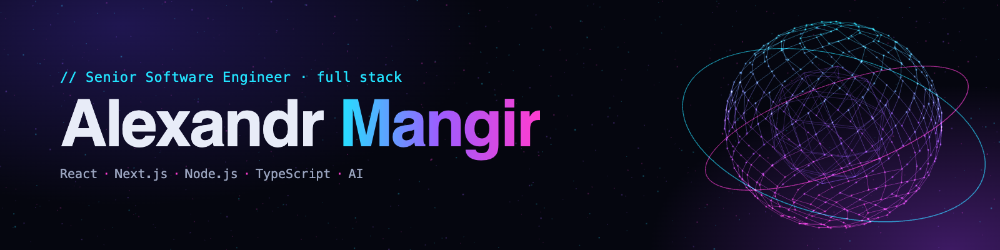
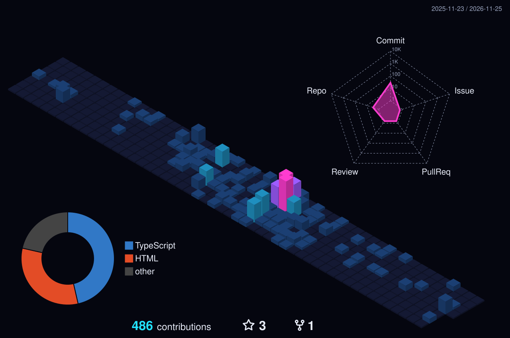

  

  
  

## About me

- 🧠 **Senior Software Engineer, full stack**: React and Next.js on the frontend, Node.js and NestJS on the backend
- ⚡ I build **high-performance, scalable systems**, from architecture and APIs to polished interfaces
- 🧩 **3 platforms** built on micro-frontends and **2 company-wide design systems**
- 🤖 **AI features in production**: LLMs, RAG, AI agents, MCP and spec-driven development with coding agents

## Tech stack

## Selected work

| Project | What it is |
| --- | --- |
| **maib design system** | Shared UI library for product teams, micro-frontends for digital banking and card management for corporate clients |
| **Otherweb & PressHub** | A junk-free news platform that uses AI to filter clickbait and misinformation, plus an AI editorial workflow for journalists |
| **[Raters](https://www.ratersapp.com/)** | A social network for movie lovers: Next.js web app, Telegram Mini App, Web3 login and an x402 paid API for AI agents |
| **Flowqe** | A web CAD for electrical engineering: diagram editor, real-time electrical calculations and DXF import/export |
| **[Everact](https://everact.io/)** | A platform to create and sell online courses: LMS, a visual drag-and-drop funnel builder and Stripe billing |
| **RAG & AI workflows** | RAG over internal knowledge, automation of routine processes and spec-driven development with coding agents |

More on the site: **[sasha95.github.io](https://sasha95.github.io/)**

## GitHub activity

